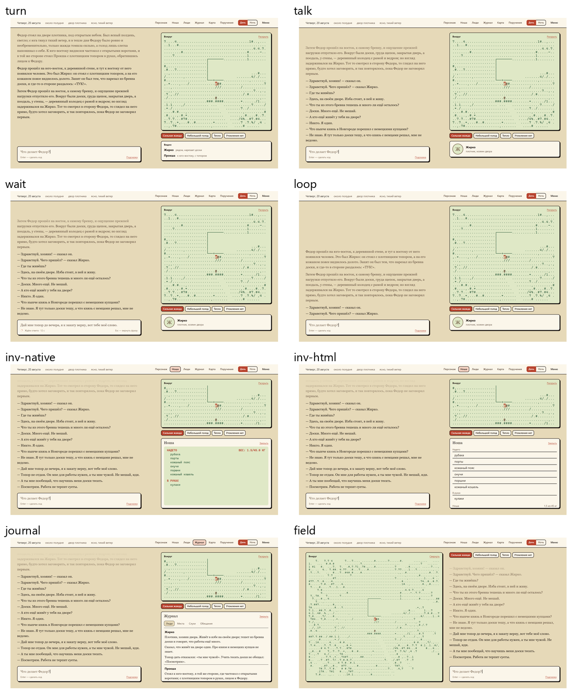
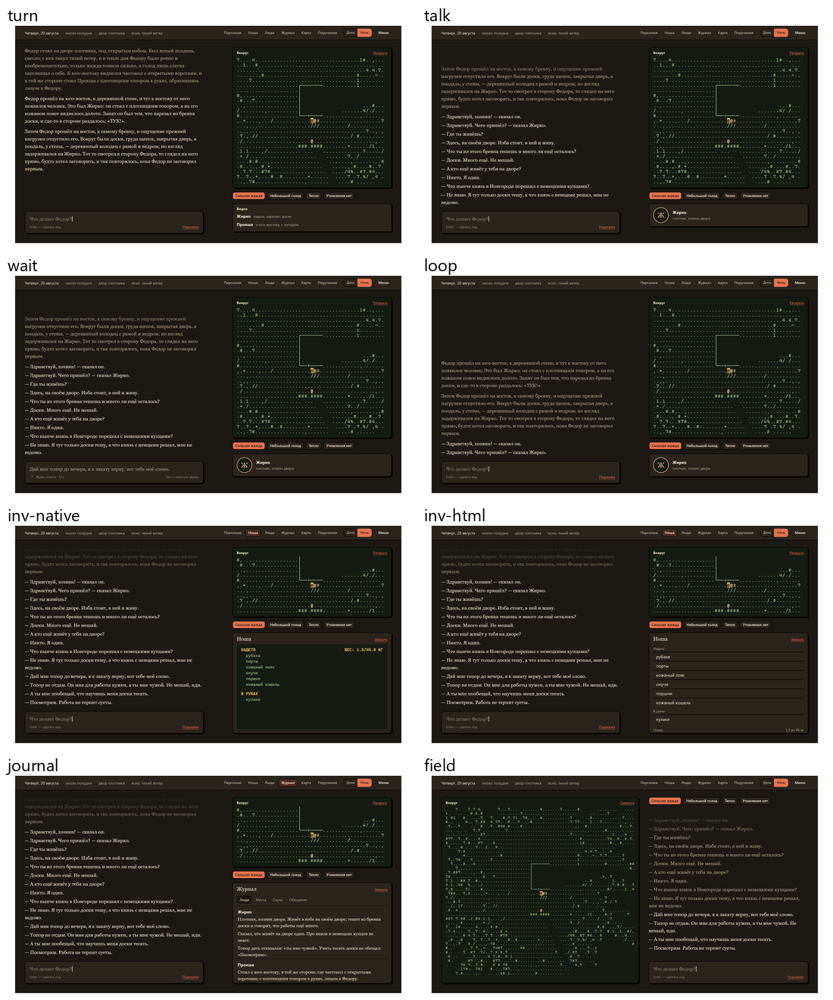

# Экран игры: карта коннекторов

> status: REFERENCE / DOMAIN GUIDE; при конфликте действуют governing-корпус (AGENTS.md), профильный контракт и `MODULE.md` владельца. Составлено 2026-11-02 для части 6 вертикального среза («экран и проза»); спецификация работы — CR в issue #996.

Карта показывает, откуда каждая зона экрана берёт данные: родное CDDA или наш слой. Основание: GDD §8 и решения в его таблице, [14-screen](../design/systems/14-screen.md). Ссылки помечены источником: `cdda:` — исходники upstream CDDA на коммите `0d8843f` (в этом репозитории их нет); `main:` — ветка `main`; `slice:` — ветка среза `claude/fix04e-devint`; `prose:` — ветка `codex/prose-chain-947`. Существование ссылок проверено скриптом; по смыслу и против GDD карту и макеты независимо сверил Codex `gpt-6.1-sol`.

## Решения владельца

- **D368** — сначала проект: карта коннекторов, макеты, затем CR; код ждёт очереди части 6.
- **D369** — оформление «Как картинки + ночная тема вечер. Будем кнопкой тему переключать» (обводка 2 px, жёсткая тень, кнопка «День / Ночь»); родные окна CDDA (ноша, обмен, поручения, настройки) — «Окно CDDA», как есть; раскладка «Как на макете»; собеседник — «Только медальон»; «в перспективе всё будет в нашей отрисовке».
- **D370** — «Да, и поле»: поле вокруг героя в перспективе — клеточная проекция в нашей отрисовке; снимок окна CDDA только временный.
- **D379** — проза хода выходит сразу после применения хода в памяти CDDA, сохранение на диск — по D215; рассказчика к живой игре подключает часть 6; окно поручений CDDA пока как есть, временно; задержка поля — не больше 100 мс в 95% случаев.

## Макеты

Дневная и ночная темы, восемь состояний экрана: ход, разговор, ожидание ответа, ноша родным окном, ноша HTML (отклонена D369), журнал, раскрытое поле, ход с репликами. Макеты показывают размещение, а не рабочие окна CDDA.

Отдельные кадры: [ход, день](assets/ui-screen/flat-turn.png), [ход, ночь](assets/ui-screen/night-turn.png), [раскрытое поле, день](assets/ui-screen/flat-field.png), [раскрытое поле, ночь](assets/ui-screen/night-field.png). Исходник макета (React и CSS, образец размещения и палитры, не код игры): [экран](assets/ui-screen/mockup/index.tsx), [стили и палитра](assets/ui-screen/mockup/screen.css), [поле](assets/ui-screen/mockup/field.ts), [проза](assets/ui-screen/mockup/prose.ts).

## Принцип

- **Коннектор** — один источник, одна проекция для экрана, только чтение. Ни один коннектор не пишет мир и не пересчитывает механику (EXP-021).
- **Ввод игрока — один канал:** фраза, клик по полю или кнопка → намерение → координатор хода → CDDA исполняет. Клик — намерение, а не результат (14-screen, «Наш слой и владелец»).
- **Владельцы.** CDDA — карта, видимость, память карты, тело, вещи, время, погода, сообщения, сохранение. Наш слой — проза рассказчика, речь NPC внутри прозы, журнал знаний героя, поручения как проекция миссий, картинки. Безопасные проекции для игрока и панели — `@rus/presentation` (`docs/design/systems/14-screen.md:71`); `apps/game-web` только рисует их.
- **Экран показывает только доступное герою** (D20, D72): ни служебных меток, ни скрытых людей за стеной.
- **По главному правилу CDDA** новое относительно движка только там, где родного нет: (1) доставка поля в браузер; (2) доставка родных окон (инвентарь, обмен, поручения, настройки) в браузер; (3) хост экрана, который собирает проекции и отдаёт их `game-web`. Всё остальное по движку — родное; рассказчик, речь NPC в прозе, ожидание ответа, сообщение о сбое рассказа и журнал знаний — наш слой (см. «Владельцы»).
- **Отрисовка: сейчас и в перспективе** (D369). Сейчас родные окна CDDA (ноша, обмен, поручения, настройки) показываются как есть. В перспективе всё будет в нашей отрисовке. Данные по-прежнему приходят через коннекторы от владельцев: коннекторы и владельцы не меняются, меняется только то, кто рисует.
- **Сквозные требования ко всем зонам:** проза не меньше 18 px (D310); смысл не только цветом (EXP-003, `docs/design/GDD.md:399`); прицела нет (EXP-023, `docs/design/GDD.md:442`); ни покачивания, ни тряски, ни размытия (EXP-041, `docs/design/GDD.md:457`); русский перевод CDDA и вся кириллица в шрифте (EXP-044, EXP-047, `docs/design/GDD.md:459`, `docs/design/GDD.md:462`).

## Главный экран

| # | Зона | Что показывает | Источник: родное CDDA или наш модуль | Сейчас | Решения |
|---|---|---|---|---|---|
| 1 | Строка обстановки | дата, часть суток словами, место по восприятию, погода, ветер | родные виджеты сайдбара: `cdda:data/json/ui/date.json:3`, `cdda:data/json/ui/time.json:3`, `cdda:data/json/ui/place.json:3`, `cdda:data/json/ui/weather.json:3`; текст виджета без отрисовки — `cdda:src/widget.cpp:994` (`widget::show`) | в CDDA — родной сайдбар («Дата: Четверг, 20 Авг», «Время: Около полудня», «Место: двор плотника»); в `game-web` — `renderContext` `main:apps/game-web/src/app/router.js:100` по полям `visible_context` и `presentation_context` ответа `apps/game-server` | D106, D114, EXP-027, D302 (часов в прозе нет) |
| 2 | Поле CDDA, компактное и раскрытое | герой, люди, вещи, местность вокруг; только видимое и запомненное героем | родная отрисовка карты, видимость и память: `cdda:src/game.cpp:3542` (`game::draw_ter`), `cdda:src/map_memory.h:101` (`map_memory`); масштаб — родной zoom `cdda:src/game.cpp:6411` (`game::zoom_in`), исходный подбирается в плейтесте; снимок окна — `cdda:src/game.cpp:6538` и `cdda:src/sdltiles.cpp:7519` (только TILES); клеточной выгрузки нет — новое | только окно CDDA: на servak под Xvfb, на рабочий стол Windows окно WSLg не выводится (`slice:tools/cataclysm-prototype/JOURNAL.md:114`) | EXP-007 (способ доставки — на прототипе), EXP-008, EXP-004, EXP-005, MEC-054, SYS-14-02, EXP-001 |
| 3 | Признаки состояния | ранение и кровотечение, жажда и голод, бодрость, тепло и холод, мокрая одежда, нагрузка, режим движения — словами | родные виджеты: `cdda:data/json/ui/thirst.json:3`, `cdda:data/json/ui/hunger.json:3`, `cdda:data/json/ui/carry_weight.json:4`, `cdda:data/json/ui/movement.json:3`, `cdda:data/json/ui/bodypart_status.json:74`; текст и цвет — `cdda:src/widget.cpp:1209` | родной сайдбар («Жажда: Сильная», «Голод: Небольшой», «Тепло: Тепло», «Вес: Обычный» — кадр живой проверки 02.11) | MEC-017, MEC-053, EXP-009, EXP-010 (только JSON), EXP-022, D282/3, SYS-14-01 |
| 4 | Проза хода | рассказ о том, что герой видел и сделал, книжно, третье лицо, прошедшее время | наш рассказчик; вход — пакет рассказчику из родного наблюдения (`prose:tools/prose-probe`, провод #961); контракт — `turn_step_llm_contract` (ACTIVE), `situational_prose_requirements` (ACTIVE) | проза получена в пробах (проба #961 и проба разговора npc-talk); экрана, где её читает игрок, у среза ещё нет — его и проектирует эта задача | D20, D161, D275/10, D302, D310 (≥18 px), EXP-043 |
| 5 | Речь NPC | дословная реплика внутри прозы, без отдельного блока | точная зафиксированная реплика (`npc_conversation_mode_contract`, ACTIVE); в CDDA — `npc::say_formatted` → звук → журнал (`slice:tools/cataclysm-prototype/native-live-input.patch:384`, `cdda:src/sounds.cpp:697`) | строка журнала CDDA «Вы слышите Жирко говорит «…»» — обёртка мешает (слепые судьи пробы разговора npc-talk, 2026-11-02) | D161 |
| 6 | Ввод фразы | поле до 1000 символов; подсказка — по запросу | веб-поле → координатор хода (`slice:tools/cataclysm-prototype/p3-live-coordinator.mjs:77`, NDJSON по сокету) → `slice:tools/cataclysm-prototype/novgorod_semantic.cpp:1135` | всплывающее окно «Свободное действие» (`slice:tools/cataclysm-prototype/novgorod_semantic.cpp:1192`), вызов по F12 (`slice:tools/cataclysm-prototype/JOURNAL.md:124`) — расходится с EXP-025 | EXP-048, EXP-065, EXP-030, EXP-037, EXP-029 |
| 7 | Ожидание ответа | подпись с индикатором; Esc возвращает фразу в поле, пока ход не записан; часы стоят | наш координатор хода | всплывающее окно ожидания (`slice:tools/cataclysm-prototype/novgorod_semantic.cpp:1031`) | EXP-071, EXP-027, EXP-025 |
| 8 | Картинка местности | вид места при свете и погоде | `game-web`: выбор авторской картинки по `scene_asset_id` — `main:apps/game-web/src/features/landscape/render-model.js:116`; 508 файлов webp в `main:apps/game-web/public` (подсчёт `git ls-tree`); после среза — генератор #908 | есть в `game-web` (старый движок) | EXP-007 (основа — `game-web` с картинками), WLD-047, #908 |
| 9 | Портрет собеседника | лицо того, с кем говорит герой | `game-web`: `main:apps/game-web/src/app/scene-canvas-hydration.js:42` (авторский или процедурный) | есть в `game-web`; для NPC среза портреты не проверялись | EXP-014 (оставлять ли — на прототипе), #981 |
| 23 | Боевые кнопки | физические боевые команды — кнопками; клик по полю помогает выбрать направление | родные действия CDDA (`cdda:src/action.h:22`, `action_id`); нажатие уходит в координатор хода как намерение | только клавиши окна CDDA | EXP-048, EXP-069 (`docs/design/GDD.md:463`, `docs/design/systems/14-screen.md:17`) |
| 24 | Сбой рассказа | короткое сообщение вне прозы и повтор без потерь: повторная фиксация хода идемпотентна | наш координатор хода и рассказчик | нет | EXP-080 (`docs/design/GDD.md:425`) |

## Панели (открываются и закрываются; проза и ввод остаются — EXP-024)

| # | Панель | Источник | Сейчас | Решения |
|---|---|---|---|---|
| 10 | Персонаж и тело | родное окно персонажа `cdda:src/player_display.cpp:1523` (`Character::disp_info`); тело — родные виджеты `cdda:data/json/ui/bodypart_status.json:214` | только окно CDDA | EXP-010, MEC-017, D282/3 |
| 11 | Ноша и снаряжение | родной список: `cdda:src/inventory_ui.h:645` (`inventory_selector`), `cdda:src/game_inventory.cpp:264` (`game_menus::inv::common`) | только окно CDDA | EXP-026, MEC-027, MEC-017, D282/4, D284 |
| 12 | Содержимое контейнера | родной список содержимого — если подойдёт для панели: окно отдельно не проверено | только окно CDDA | EXP-015 |
| 13 | Обмен у торговца | `cdda:src/npctrade.cpp:294` (`npc_trading::trade`), `cdda:src/trade_ui.cpp:122` | только окно CDDA | SYS-20-01 |
| 14 | Поручения | `cdda:src/mission_ui.cpp:499` (`game::list_missions`), `cdda:src/mission_ui.cpp:112`; строка на поручение — короткое состояние и причина, если герой её знает, без целей и отметок «выполнено»; запись в журнале (`docs/design/systems/14-screen.md:43`) | только окно CDDA; подходит ли список миссий — проверить | VIS-030, EXP-077 |
| 15 | Журнал знаний героя | наш: люди, места, слухи, обещания, впечатления — только известное герою; у слуха источник и пометка «видел сам / слышал», правдивость не помечается | в CDDA нет; в старом движке — панель `journal` `game-web` | EXP-028, EXP-074, D275/5 |
| 16 | Карта знаний | родная обзорная карта и память героя (`docs/context/cdda-native-map/areas/11-ui-display.md:12`) как проекция знания | только окно CDDA | EXP-028, MEC-054 |
| 17 | Журнал CDDA | `cdda:src/messages.h:28` (`recent_messages`) — по желанию игрока | родной сайдбар | EXP-069 |
| 18 | Рецепты (справка) | родное окно рецептов `cdda:src/crafting_gui.cpp:2971`, только известное герою | только окно CDDA | MEC-033, EXP-030 |
| 19 | Люди | видимые сейчас — родной список видимых NPC сайдбара; знакомые вне видимости — из журнала знаний (строка 15) | родной сайдбар («@ Жирко @ Прокша») | EXP-021, EXP-028 |
| 25 | Навыки | родная вкладка навыков окна персонажа `cdda:src/player_display.cpp:790` (`draw_skills_tab`) | только окно CDDA | EXP-010 (`docs/design/GDD.md:406`) |
| 26 | Подпись «Стайка: N» | число в панели и при осмотре; проза называет птиц словами без счёта; источник числа — механизм стай, владельца назначает CR | нет | SYS-14-01 (`docs/design/systems/14-screen.md:105`) |

## Меню

| # | Что | Источник | Решения |
|---|---|---|---|
| 20 | Главное меню, новая игра | `game-web` (готовые экраны) | EXP-031, EXP-032 |
| 21 | Сохранить, загрузить, настройки, клавиши, выход | родное сохранение, ручное — только на устойчивой границе хода (`docs/design/GDD.md:468`); `cdda:src/options.cpp:3544` (`options_manager::show`); `cdda:src/input_context.cpp:46` (`keybindings_ui`, окно ImGui) | EXP-033, EXP-034, EXP-049 |
| 22 | Окно отката после сбоя | часть 7 среза | EXP-025, D216 |

## Решённые развилки

1. **Хост экрана.** Сейчас `game-web` ходит по HTTP в `/api/v1` (`main:apps/game-web/src/api/client.js:26`), отвечает `apps/game-server` старого движка (`main:apps/game-server/src/http/handler.js:50`), а ход среза идёт через координатор p3 по сокету. Хост и транспорт экрана части 6, доставку родных окон и запуск из меню берёт `tools/cataclysm-prototype` с правкой своего `MODULE.md` (CR).
2. **Поле CDDA в браузер** (EXP-007): итог — клеточная проекция в нашей отрисовке (D370); снимок окна — временная мера. Родная сборка CDDA под браузер (Emscripten: `cdda:src/main.cpp:578`, `cdda:src/sdltiles.cpp:7178`) переносит в браузер весь клиент, а не поле отдельно ([14-screen](../design/systems/14-screen.md), строка 75). Способ клеточного экспорта выбирает прототип по доле своего кода, задержке (не больше 100 мс в 95% случаев, D379) и фильтру скрытого.
3. **Родные окна в браузер:** сейчас окно CDDA как есть внутри панели (D369), в перспективе — всё в нашей отрисовке.
4. **Память карты** обновляется при отрисовке ([11-ui-display](cdda-native-map/areas/11-ui-display.md), строка 11): если браузерный путь не вызывает отрисовку CDDA, прототип доказывает совместимую дорогу без второго владельца памяти.
