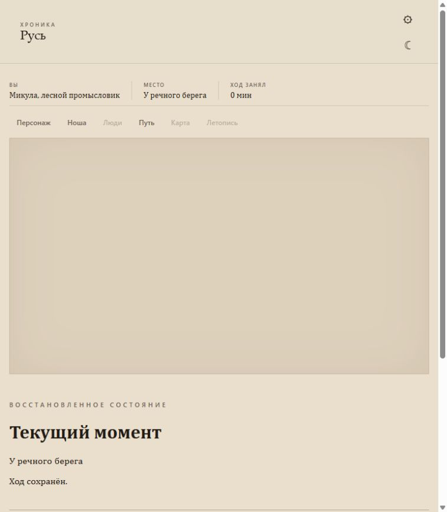

# D49: живой прогон 5ba92a85 — отказы repair и доставки результата

## Identity

- Date: 2026-10-18
- Run: `party:9403b0967646e4940e15b488`
- Scenario: `novgorod_vikhtuy_work_storage_v1` — «На хозяйственном дворе», Vikhtuy
- Repository HEAD: `5ba92a85d6cbc41d5ae6b7e4f9b1b0a43efbf9e0`
- Client: browser UI; isolated v17 PostgreSQL fixture
- LLM: production OpenAI-compatible provider, model `qwen3.8-27b-uncensored-w4a16-tp2`

## Preconditions

- The configured LLM passed its initial qualification (19 calls) before the run. No further qualification calls were made.
- The party was created for this run. The party event log records four submitted actions, two completed and two failed.
- Evidence reviewed: player-visible event output, the UI capture through reload, and the final read-only database snapshot. Private provider traces and hidden state remain outside this report.

## Gameplay transcript

### Opening

Микула стоял на хозяйском дворе, глядя на то, как серые облака, низко нависшие над кронами, медленно сливались с горизонтом. Лесной промысловик привык к капризам погоды, но сегодня дождь шёл особенно упрямо, превращая воздух в густую, холодную вуаль. Слабый ветерок лишь слегка колышал ветви, не принося с собой ни свежего воздуха, ни обещания скорого прояснения. В такой день, когда видимость падала, а мир сужался до нескольких шагов вокруг, даже знакомые очертания деревьев на кромке берега теряли свою привычную чёткость, становясь лишь смутными, тёмными пятнами в серой дымке.

Он чувствовал, как влага пропитывает его одежду: нижняя рубаха прилипала к телу, а штаны становились тяжелее. Низкая кожаная обувь, хоть и защищала от грязи, не спасала от холода, который поднимался от мокрой земли. Микула не был голоден, и в его теле не было ни боли, ни усталости, накопленной за долгие дни в лесу. Силы оставались, и тело было готово к работе, но сейчас, стоя под небом, затянутым сплошной пеленой, он просто наблюдал за тем, как вода стекает по листьям, создавая ровный, монотонный шум, который заглушал все остальные звуки дня.

### Turn 1

**Player input:** `Выхожу со двора по глинистой тропе.`

**UI:** «Результат сохранён. Готовим сцену», затем «Дольше целевых 30 секунд; обработка продолжается. Точное время окончания неизвестно.» На итоговом экране показаны Микула, «У речного берега» и «12 мин». Текст результата:

> Микула шагал по глинистой тропе, пока не вышел на ровную пойменную землю. Он остановился. Впереди различалась вода, кромка берега и очертания деревьев.

После хода панель «Люди» показывала единственную строку «человек».

**Domain outcome:** переход по глинистой тропе сохранён; текущее место — «У речного берега», прошло 12 минут. Формулировки о ровной земле и остановке выше принадлежат прозе и сами по себе не доказывают отдельного механического события.

**Commit:** completed, state version 1.

### Turn 2

**Player input:** `Осматриваюсь у берега, стараясь разглядеть человека поблизости и то, чем он занят.`

**UI:** «Ход не сохранён. Попробуйте сформулировать действие иначе.»

**Domain outcome:** `TURN_STEP_PLAN_INVALID`; validation reported `domain_owner_unavailable`.

**Commit:** failed; no completed event. Последняя подтверждённая версия осталась 1.

### Turn 3

**Player input:** `Обращаюсь к человеку у берега: «Здрав будь. Я Микула. Чем здесь можно заняться, чтобы добыть себе еды?»`

**UI:** «Действие временно недоступно. Попробуйте ещё раз.»

**Domain outcome:** `TURN_NPC_PLAN_NOT_APPLICABLE`.

**Commit:** failed; no completed event. Последняя подтверждённая версия осталась 1.

### Turn 4

**Player input:** `Подхожу ближе к человеку у берега.`

**UI:** «Результат сохранён. Готовим сцену», затем «Дольше целевых 30 секунд; обработка продолжается. Точное время окончания неизвестно.» Дерево доступности после этого не изменилось; новая сценная выдача не появилась.

**Domain outcome:** ход завершён и сохранён как версия 2; narration не был доставлен в UI.

**Commit:** completed, state version 2.

**UI failure:** `TypeError: Cannot read properties of undefined (reading 'length')` while rendering factual turn delivery. После перезагрузки «Продолжить» оставалось disabled, отображалось «Загрузка…», а ошибка повторилась во время восстановления партии. UI capture завершён после этой ошибки.

## Persistence/readback

После перезагрузки выполнен read-only snapshot тем же snapshot reader, встроенным в стенд. Snapshot `snapshot-004.private.json` сохранён вне репозитория; в этом отчёте приведены только версия и количества.

- Persisted state version: 2
- Player character and current position: present
- Placements in current scene: 1; all NPC placements: 1
- Items / party items: 7 / 7
- Resource nodes / resource decrements: 1 / 0
- NPC conversation statements: 0

Пара событий `turn.completed` соответствует версиям 1 и 2; два `turn.failed` не создали новых commit.

## Findings

1. UI не смог отрисовать доставку фактического результата после committed turn 4. Захваченный owner-side `output.screen` имеет schema `factual_turn_delivery_screen`; optional-поле `exact_npc_utterances` отсутствует. UI валидатор допускает это, но renderer читал `.length` без проверки. Raw HTTP body не сохранён; отдельно проверена штатная public-проекция исходного экрана. UI capture фиксирует ошибку при рендере и её повтор после восстановления. Продолжить эту партию через UI не удалось.
2. Наблюдение за человеком завершилось `TURN_STEP_PLAN_INVALID` из-за `domain_owner_unavailable`; обращение к нему завершилось `TURN_NPC_PLAN_NOT_APPLICABLE`.
3. Два независимых prose review оценили фактическую обоснованность opening и финального текста turn 1 как FAIL. Оба результата ниже литературного порога; оценки живости разошлись (opening 6–7/10, turn 1 2–4/10), как и protocol-оценки обоих текстов (opening: no/partly; turn 1: yes/partly). В финальном тексте turn 1 «Впереди» задаёт неподтверждённое направление воды и берега.
4. Фактические события игры сохранились до state version 2, но успешный commit turn 4 не привёл к отображаемой новой сцене.

## Result

**FAIL.** Маршрут «разговор → вещь» не пройден. Два из четырёх действий завершились domain failure; committed turn 4 оставил партию на версии 2, но UI упал при доставке результата и не восстановился после перезагрузки. Независимые prose review также не приняли opening и финальный текст turn 1 по фактической обоснованности.

## Последующее исправление UI — отдельная проверка

Коммит `8d4e2bb4639d15f9320ae5a75f9a72632f5671fb` исправляет общий renderer optional-списка реплик. Красный regression до правки воспроизводил `TypeError`; после правки прошли 181 UI-тест, syntax, architecture и docs checks. Независимый Contract Auditor подтвердил соответствие существующему optional-контракту; assertions не ослаблены.

Во встроенном браузере отдельно воспроизведён захваченный owner-side экран через штатную public-проекцию и исправленные production UI store/renderer. После загрузки и reload показаны «Восстановленное состояние», «У речного берега», «Ход сохранён.» и активное поле действия; ошибок браузера нет. Стенд сначала не загружал зависимость `packages/contracts/src/portrait-spec-v1.js`; после добавления её штатного пути проверка состоялась. Это воспроизведение сохранённого экрана без модели и БД, не новый D49 и не доказательство полноценного сохранения/загрузки игры.

## Проверки и очистка

Полный CI на исходном exact HEAD `5ba92a85` прошёл: [run 39081511839](https://github.com/PavelSlaven/Novgorod1230/actions/runs/39081511839), 10/10 jobs. По TAP: 8 776 запусков тестов, 8 762 pass, 0 fail, 14 skip. Это число запусков, не уникальных тестов. Пропуски: Windows-only acceptance (1), legacy D97 revision 34/35 (3), opt-in live/capture стенды (3), Docker cleanup self-check (1), integration без обязательных DB URLs (6). Зелёный CI не отменяет найденные live-отказы и не покрывает последующие HEAD.

Четыре игровых запроса сделаны однократно, без ручных повторов. Помимо 19 квалификационных вызовов, фактические игровые запросы модели включали штатные audit/repair. После остановки run модель повторно не вызывалась. Старые сохранения и настройки провайдера не менялись.

Стенд, его собственные PostgreSQL container/volume и проверенная временная папка очищены. Процесс и порт стенда отсутствуют; принадлежащий run SSH-туннель и обе тестовые вкладки закрыты. Остальные БД и службы моделей не затронуты. Частные traces и readback остаются вне репозитория.