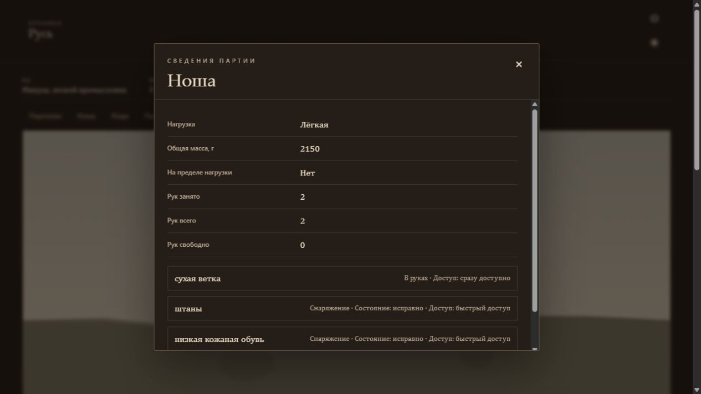

# D49: fdca62a78 — вещь сохраняется, разговор и проза не приняты

## Identity

- Date: 2026-10-18.
- Run: `party:55051abd034ff142ffe68cea`.
- Scenario: `novgorod_vikhtuy_work_storage_v1`, «На хозяйственном дворе», Вихтуй; Микула, лесной промысловик.
- Runtime HEAD: `fdca62a7862a4c5032e26afa330b88fa6c2f30a0`.
- Client: встроенный браузер, явно разрешённый пользователем; свежие изолированные PostgreSQL world/party DB.
- LLM: `qwen3.8-27b-uncensored-w4a16-tp2`, штатный production provider.

## Preconditions

Полный [CI runtime-кандидата](https://github.com/PavelSlaven/Novgorod1230/actions/runs/39098367778) прошёл: 10/10 jobs; 8784 выполнения тестов, 8770 PASS, 14 SKIP, 0 FAIL. Это сумма выполнений, не уникальных тестов. [Отчёт CI](../work/audits/d49-ci-fdca-final.md) отдельно перечисляет пропуски.

Пользователь разрешил один диагностический прогон до 12 ходов без ручных повторов. После четвёртого запроса пользователь попросил закончить ближайшую задачу и остановиться; выполнены только reload/readback и cleanup. Старые сохранения не мигрировались.

Штатный owner принял сохранённую qualification v71. До создания партии provider capture отсутствовал: новых квалификационных вызовов не было. Игра использовала 34 provider calls; четыре пользовательских запроса имели разные request/idempotency keys. Внутренний штатный repair не является ручным повтором.

До игры исправлены только внешние файлы собственного стенда: право исполнения preflight, cwd exact clone, штатный AppArmor opt-in тестового PG, полное наследование `wk_giga_env()` и `umask 077`. Неудачные bootstrap завершались до Qwen; их диагностика сохранена отдельно. Production Giga readiness прошёл в том же env/cwd. Независимый read-only аудит подтвердил exact HEAD, все 39 workspace links внутри clone, штатный settings path и lifecycle; найденный доступ к party log ограничен и перепроверен. Runtime-код при запуске не менялся.

## Gameplay transcript

Текст ниже дословно извлечён из сохранённых browser accessibility captures. «Запрос» означает порядковый пользовательский ввод; неуспешный запрос не получил серверный номер хода.

### Opening

Микула стоял на хозяйском дворе, где низкая, ровная земля была покрыта илистым и глинистым грунтом. Лето стояло в разгаре, небо затянули облака, но осадков не было, а ветер либо отсутствовал, либо дул так слабо, что его почти не чувствовалось. В его штанах, низкой кожаной обуви и нижней рубахе не было ни единой раны; силы для работы оставались в избытке, а сильного голода он не испытывал. Его взгляд скользнул по кромке берега, где виднелся речной проток, и по отдельным деревьям, среди которых густо рос нижний ярус растительности: трава, осоки и кустарник. У самой воды зелень была особенно густой, а на поверхности земли лежали остатки срезанных трав и обломки ветвей.

### Запрос 1 — выход

**Player input:** `Выхожу со двора по глинистой тропе.`

**UI:** после «Результат сохранён. Готовим сцену» — место «У речного берега», «12 мин».

Глина под ногами Микулы поддалась, оставляя влажные, тёмные отпечатки. Тропа, вытоптанная по ровной пойме, вела прямо к воде, где низкий берег обрывался в проток. Воздух стоял неподвижный, без ветра, и лишь тяжелые облака, затянувшие небо, приглушали дневной свет, не давая ему пробиться сквозь листву. Микула чувствовал, как низкие кожаные башмаки впитывают сырость, а неокрашенный лён рубахи прилипает к телу. Впереди, среди осоки и кустарника, виднелся силуэт: крепкий пожилой мужчина с русой короткой бородой и зелеными глазами. В его руках была рыболовная сеть, и он стоял на самой кромке берега, где илистый грунт переходил в воду.

**Domain outcome / commit-state:** переход завершён; state version 1. В панели «Люди» доступен один человек.

### Запрос 2 — разговор

**Player input:** `Обращаюсь к мужчине с сетью: «Здрав будь. Я Микула. Чем здесь можно заняться, чтобы добыть себе еды?»`

**UI:** «Ход не сохранён. Попробуйте ещё раз.» Предыдущая сцена осталась на экране; новая реплика NPC игроку не показана.

**Domain outcome / commit-state:** `TURN_NPC_PLAN_INVALID`, validation `TRACE_NPC_SPEECH_GROUNDING_UNSUPPORTED`. Финальный grounding audit после repair отклонил фактический фрагмент без исходного claim. Provider transport/JSON ошибки не зафиксированы. События завершения и новой версии нет; запрос не повторялся.

### Запрос 3 — поиск вещи

**Player input:** `Ищу у берега подходящую сухую ветку для растопки.`

**UI:** «15 мин».

Микула остановился, когда взгляд зацепился за сухую ветку, лежавшую на глинистой тропе. Она не была в его руках, когда он её заметил, и он просто посмотрел на неё, стоя на месте. Вокруг расстилалась низкая, ровная пойменная земля, покрытая илистым грунтом, травой, осоками и кустарником. Впереди, у самой кромки берега, виднелся речной проток, а в воде и на её поверхности плавали остатки трав, осок и обломки ветвей. Небо было затянуто облаками, но день стоял светлый, без осадков и ветра. В нескольких шагах, среди растительности у воды, Микула увидел пожилого мужчину. Тот был крепкого телосложения, со светлой кожей, овальным лицом, зелёными глазами и русыми волнистыми волосами, короткой бородой. На нём была тонкая льняная рубаха с круглым вырезом и узкими рукавами, а ниже пояса — прямая нижняя одежда из неокрашенного льна. На ногах мужчина носил низкие кожаные башмаки коричневого цвета. В руках он держал рыболовную сеть. Микула, сам одетый в нижнюю рубаху, штаны и низкую кожаную обувь, стоял и смотрел на этого человека, не делая ни одного шага.

**Domain outcome / commit-state:** обнаружена новая сухая ветка; state version 2. Запас конечного источника уменьшился один раз: 100 → 99.

### Запрос 4 — взятие

**Player input:** `Поднимаю найденную сухую ветку.`

**UI:** «1 мин».

Микула остановился на глинистой тропе, где мягкий, илистый грунт под низкими кожаными башмаками слегка пружинил. Вокруг расстилалась низкая, ровная пойма, усеянная травой, осоками и кустарником, а впереди, за кромкой берега, серебрился речной проток. День стоял светлый, но небо было затянуто облаками, и воздух оставался безветренным, лишь слабо шевеля верхушки отдельных деревьев. Неподалеку, среди остатков обломков ветвей, Микула заметил сухую ветку, вынесенную сюда, вероятно, течением. Он наклонился, поднял её и сжал в ладони, чувствуя, как шершавая кора впитала в себя летнюю сухость.

**Domain outcome / commit-state:** та же ветка перешла в руки героя; state version 3. Панель «Ноша»: сухая ветка «В руках · Доступ: сразу доступно», масса 2150 г вместо исходных 2100 г. Повторного списания ресурса нет.

## Persistence/readback

После завершения четвёртого запроса выполнена полная перезагрузка страницы и «Продолжить». Восстановились та же сцена, дословно тот же последний текст, NPC и доступный ввод. Ветка остаётся в руках; масса ноши — 2150 г.

Сохранённые snapshots до и после reload имеют state version 3. Совпадают `items`, `party_items`, `resource_nodes`, `resource_decrements`, `npc_placements_all`, `placements_here`, `npc_statements`. Identity, holder и положение ветки не меняются. Источник остаётся на 99; списание ровно одно, NPC statements не появились. Полные private snapshots и provider traces находятся вне Git.

Снимки завершённых ходов имеют версии 1, 2, 3; снимок после загрузки — 3. Отдельного post-failure snapshot или rollback-события для запроса 2 нет, поэтому явная операция rollback этим прогоном не доказывается.

## Findings

- Разговор остаётся заблокирован. Read-only диагностика полных входов NPC установила: repair сохранил подтверждённый request факт, для которого исходный ответ не создал claim. Восстановление выбранных `claim_ids` соответствует контракту; финальный отказ по `unclaimed_factual_utterance` обоснован. Доказанной потери входных данных сервером в этом случае не найдено. Точное скрытое содержание отклонённой реплики здесь не публикуется.
- Художественность не принята. Два независимых слепых судьи, читавших полный actual input и эталон Opus, дали вступлению 3/10 и 2/10, первому ходу — оба 5/10 при пороге 8. Вступление признано протокольным; по протокольности первого хода оценки разошлись: 0 нарушений против частичной протокольности. Оба судьи отвергли фактическую/смысловую приёмку, с различиями в трактовке отдельных деталей D158. Эти оценки не заменены средним PASS.
- В первом ходе пройденный путь и прибытие дошли до writer, audit и repair. Проза передаёт завершение перехода неявно, а модель-аудитор засчитала покрытие. Независимый разбор не установил потерю wire или нарушение текущего кодового контракта; проблема модельной оценки остаётся открытой.
- Поиск, взятие одной вещи и reload прошли. Следующая порция, исчерпание, конкуренция и replay одного запроса в этом живом прогоне не проверялись. Они не объявляются доказанными этим отчётом; профильные автоматические проверки входят в отдельный CI.
- Тексты поиска и взятия сохранены дословно, но отдельной литературной оценки до пользовательской остановки не получили.

## Result

**D49 FAIL / не принят.** Выход, видимый человек, обнаружение и взятие вещи с последующей загрузкой подтверждены. Содержательный разговор не состоялся; художественная проза устойчиво не достигнута. Это не приёмка M2c.

Остановка выполнена по просьбе пользователя после четырёх запросов. Собственный сервер завершён через SIGTERM; `CLEANUP=done`, его процесс и уникальный PG container отсутствуют. Собственный SSH tunnel и browser tab закрыты. Чужие checkout, сохранения и модельные службы не изменялись. Артефакты сохранены для продолжения; новых исправлений после остановки не начинали.
